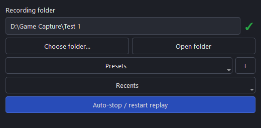
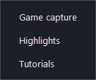
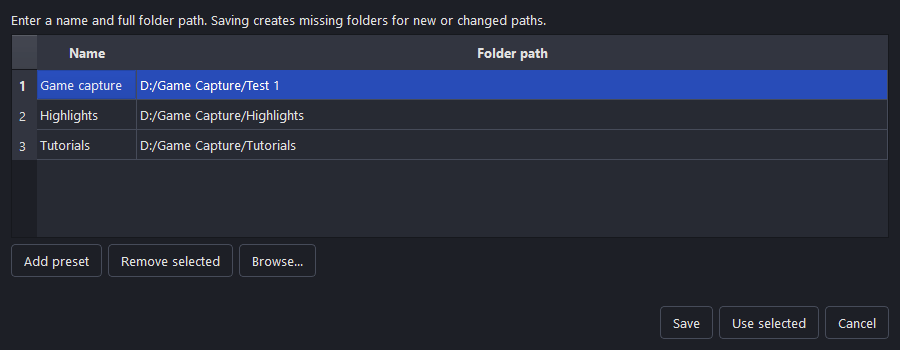
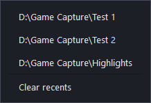
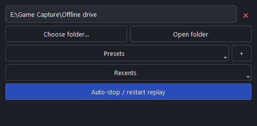

# Recording Folder Dock

Change your OBS recording folder from a dock. Save presets, return to recent folders, and switch destinations without opening Output Settings.

[**Download**](https://github.com/technicallyalex/recording-folder-dock/releases/latest) · [Report an issue](https://github.com/technicallyalex/recording-folder-dock/issues) · [Build from source](docs/DEVELOPMENT.md)

## Features

- **Choose folder** selects a destination; **Open folder** opens it in your file manager.
- **Presets** applies a saved location. **+** opens configuration with folder browsing and manual paths. Saving a new path creates missing folders. Selecting a preset recreates its folder if it was deleted.
- **Recents** lists the last ten successful destinations, with **Clear recents** at the bottom.
- **Auto-stop / restart replay** stops recording and replay before a folder change, then starts replay after a successful selection. The toggle remembers its state.
- A green **✓** indicates the folder exists and reports read/write access; a red **×** indicates it is unavailable or restricted.

Preset configuration and recent folders

Screenshots show the plugin widgets with sample paths. Appearance follows your OBS theme.

## Installation

Download the package for your OBS installation, close OBS, and follow the matching instructions:

| Platform | Package | Install |
| --- | --- | --- |
| Windows x64 | `windows-x64.zip` | Extract and copy `recording-folder-dock` into `C:\ProgramData\obs-studio\plugins\`. |
| Native Linux x86-64 | `linux-x86_64.tar.gz` | Extract, then run `bash install-linux.sh` from the extracted folder. |
| OBS Flatpak x86-64 | `flatpak-x86_64.flatpak` | Run `flatpak install --user ./recording-folder-dock-VERSION-flatpak-x86_64.flatpak`. |

Restart OBS and enable **Docks → Recording Folder**.

Windows requires 64-bit OBS 31.1 or newer. The native Linux package targets Ubuntu 24.04 with the OBS Project PPA; other distributions can [build from source](docs/DEVELOPMENT.md) or use OBS Flatpak. Flatpak folder access follows OBS's sandbox permissions.

For portable Windows OBS, copy the DLL into its `obs-plugins\64bit` folder. To uninstall, close OBS and remove the installed plugin folder; Flatpak users can run `flatpak uninstall --user com.obsproject.Studio.Plugin.RecordingFolderDock`.

## Using the dock

Folder changes apply to the current profile's recording output, including subsequent replay sessions. Presets, recents, and the automatic toggle are shared across profiles. Existing recordings stay where they are.

With automatic mode off, stop recording and replay before changing folders. With it on, recording stays stopped after a change; only replay restarts. **Canceling leaves outputs stopped, and stopping replay discards unsaved replay footage.** Enable Replay Buffer in OBS Output Settings to use automatic restart.

The dock supports Simple, Advanced Standard, and Custom FFmpeg with **Output to File** enabled. Folder selection checks actual write access; the availability icon is a lightweight filesystem check.

Licensed under [GPL-2.0-or-later](LICENSE).
